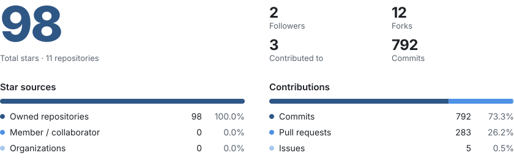

  <small><strong>English</strong> · <a href="./README.zh-CN.md">简体中文</a></small>

# CCCCY

<strong>☕ Powered by coffee &amp; AI.</strong>

  &nbsp;
  

I'm CCCCY. I build, experiment, and create — from AI agents to developer tools and everything in between.

I enjoy exploring new technologies, solving real-world problems, and turning ideas into practical software. Always curious, always building.

I'm full of curiosity, love exploring the unknown, and enjoy figuring out how things work. I believe the best way to learn is to build something yourself.

<!-- repositories starts -->

  
  <strong><a href="https://github.com/CCCCY-ci/ctxhop">ctxhop</a></strong> &nbsp; ★&nbsp;64 
  Continue the same AI coding session on another machine. No server, no account, your own storage.

  
  <strong><a href="https://github.com/CCCCY-ci/wxmini-kit">wxmini-kit</a></strong> &nbsp; ★&nbsp;34 
  A personal toolkit for inspecting and unpacking WeChat mini-program packages.

<!-- repositories ends -->

