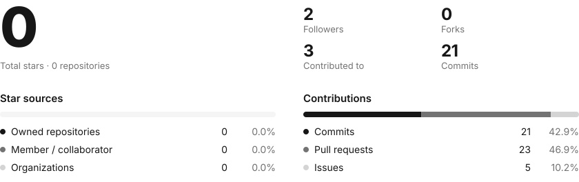

  <small><strong>English</strong> · <a href="./README.zh-CN.md">简体中文</a></small>

# CCCCY

<strong>☕ Powered by coffee &amp; AI.</strong>

  &nbsp;
  

I'm CCCCY, a builder and engineer focusing on AI coding agents, developer tooling, and productivity systems.

Creator of <a href="https://github.com/CCCCY-ci/ctxhop">ctxhop</a> (seamless cross-machine AI coding session continuity) and <a href="https://github.com/CCCCY-ci/wxmini-kit">wxmini-kit</a>.

<!-- repositories starts -->

  
  <strong><a href="https://github.com/CCCCY-ci/ctxhop">ctxhop</a></strong> &nbsp; ★&nbsp;64 
  Continue the same AI coding session on another machine. No server, no account, your own storage.

  
  <strong><a href="https://github.com/CCCCY-ci/wxmini-kit">wxmini-kit</a></strong> &nbsp; ★&nbsp;34 
  A personal toolkit for inspecting and unpacking WeChat mini-program packages.

  
  <strong><a href="https://github.com/CCCCY-ci/Cities-Skylines-Agent">Cities-Skylines-Agent</a></strong> &nbsp; ★&nbsp;0 
  Commercial-grade Cities: Skylines 1 agent system with Node.js/TypeScript agent and C# bridge.

  
  <strong><a href="https://github.com/CCCCY-ci/open-design">open-design</a></strong> &nbsp; ★&nbsp;0 
  Open-source design engine plugin for AI coding agents: prototypes, landing pages, dashboards, and export.

  
  <strong><a href="https://github.com/CCCCY-ci/figma-mcp-rust">figma-mcp-rust</a></strong> &nbsp; ★&nbsp;0 
  Figma MCP server built with Rust, providing full read/write workspace access via plugin without REST rate limits.

<!-- repositories ends -->

