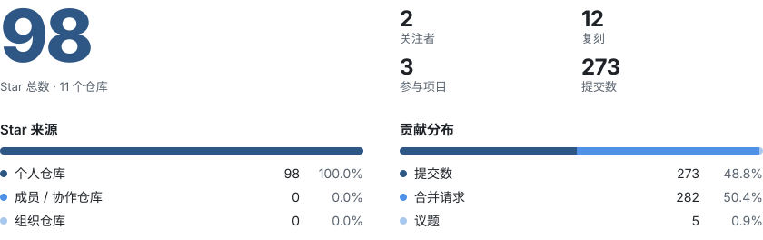

  <small><a href="./README.md">English</a> · <strong>简体中文</strong></small>

# CCCCY

<strong>☕ Powered by coffee &amp; AI.</strong>

  &nbsp;
  

我是 CCCCY。我构建、实验并创造——从 AI 智能体到开发者工具，以及这之间的一切。

<!-- repositories starts -->

  
  <strong><a href="https://github.com/CCCCY-ci/ctxhop">ctxhop</a></strong> &nbsp; ★&nbsp;64 
  在另一台设备上无缝继续同一个 AI 编程会话。无需中心服务器，无需注册账号，存储完全自持。

  
  <strong><a href="https://github.com/CCCCY-ci/wxmini-kit">wxmini-kit</a></strong> &nbsp; ★&nbsp;34 
  微信小程序代码包解析、扫描与解包工具套件。

<!-- repositories ends -->

